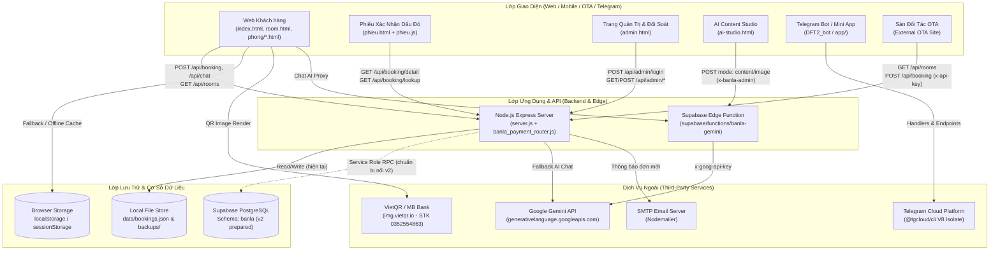

# KIẾN TRÚC TỔNG THỂ HỆ THỐNG BANLA (`ARCHITECTURE.md`)

> **Trạng thái tài liệu:** Khởi tạo Giai đoạn 0 (Orchestrator Baseline)  
> **Cập nhật lần cuối:** 2026-11-04

---

## 1. Sơ đồ Kiến trúc Tổng thể

Hệ thống Banla được thiết kế theo mô hình **Hybrid Multi-Tier Architecture** (vừa hoạt động độc lập như Static Site trên GitHub Pages / Cloudflare, vừa hoạt động đầy đủ tính năng với Node.js Express Backend và Supabase PostgreSQL + Edge Functions).

---

## 2. Chi tiết các thành phần Kỹ thuật

### 2.1. Frontend (Web & Giao diện Người dùng)
- **Công nghệ:** HTML5 ngữ nghĩa, CSS3 Custom Properties theo Design System *Highland Mist + Ember* ([`DESIGN.md`](../DESIGN.md), [`styles.css`](../styles.css), [`effects.css`](../effects.css)), Vanilla JavaScript ES6+ ([`script.js`](../script.js), [`phieu.js`](../phieu.js), [`banla-concierge.js`](../banla-concierge.js)).
- **Thư viện Client nội bộ (`vendor/`):**
  - `vendor/anime.umd.min.js` (Anime.js v4): Hiệu ứng chuyển động hero, scroll reveal.
  - `vendor/html2canvas.min.js`: Kết xuất Phiếu xác nhận dịch vụ khổ A4 ra ảnh PNG chất lượng cao.
- **PWA & Caching:** [`sw.js`](../sw.js) triển khai chiến lược Network-First cho điều hướng HTML để tránh lỗi lưu cache cũ khi cập nhật.
- **Artefact Next.js lẻ (`page.tsx`, `utils/supabase/*.ts`):** Trong thư mục gốc hiện có 1 file [`page.tsx`](../page.tsx) và các helper `@supabase/ssr` trong [`utils/supabase/`](../utils/supabase/server.ts) (dùng cho mô hình Next.js App Router), nhưng dự án chính hiện chạy bằng Express + HTML/JS thuần.

### 2.2. Backend (`server.js` & `banla_payment_module/`)
- **Runtime & Framework:** Node.js (CommonJS) + Express `^4.18.2`.
- **Bảo mật tầng HTTP:**
  - `helmet` (`^8.0.0`): Thiết lập HSTS, `X-Frame-Options: SAMEORIGIN`, `Referrer-Policy`.
  - `express-rate-limit` (`^7.4.0`): Chia 4 bộ giới hạn tần suất độc lập (`limiter` chung 100 req/15p, `adminLoginLimiter` 10 req/15p, `bookingLimiter` 10 req/60p, `lookupLimiter` 30 req/15p).
  - Chặn truy cập trực tiếp bằng regex middleware đối với các thư mục/file nội bộ (`/data`, `/node_modules`, `/test`, `/docs`, `/scripts`, `/utils`, `server.js`, `package.json`, `supabase_schema.sql`, `.env`, dotfiles).
- **Module Thanh toán (`banla_payment_module/backend/banla_payment_router.js`):**
  - Gắn tại prefix `/api/banla`.
  - Quản lý phiên thanh toán VietQR, kênh SSE (`/api/banla/session/:sessionId/stream`) và cổng nhận Webhook ngân hàng (`/api/banla/webhook`) xác thực bằng chữ ký HMAC-SHA256 (`BANLA_WEBHOOK_SECRET`).

### 2.3. Database & Storage
- **Hiện trạng lưu trữ đang chạy (Active Runtime Storage):**
  - Danh mục phòng tĩnh: [`rooms.json`](../rooms.json) (được cache trên RAM qua `getRoomsData()`).
  - Đơn đặt phòng phía Server: [`data/bookings.json`](../data/bookings.json) (ghi nguyên tử qua file `.tmp` rồi `fs.renameSync`).
  - Sao lưu định kỳ: [`scripts/backup_db.js`](../scripts/backup_db.js) xuất snapshot ra `data/backups/banla_backup_<timestamp>.json` và tự động dọn bản cũ quá 30 ngày.
  - Lưu trữ tạm phía Trình duyệt: `localStorage` (`BANLA_BOOKINGS_STORE`) và `sessionStorage` (`banla_concierge_history_v1`).
- **Cơ sở dữ liệu Đám mây (Supabase PostgreSQL — Project `hcikbpvzbzottxoitujl`):**
  - Quy định bắt buộc: Cô lập hoàn toàn trong schema `banla` (tuyệt đối không đụng vào schema `public` của dự án `webmoi`).
  - Trạng thái thực tế: Chưa chạy migration trên Supabase thật (`PGRST106`). Bản [`supabase/sql/banla_schema_v2.sql`](../supabase/sql/banla_schema_v2.sql) đã được viết hoàn chỉnh và kiểm thử 100% trên PGlite ([`test/schema_v2.test.js`](../test/schema_v2.test.js)), sẵn sàng chạy khi chủ dự án duyệt.

### 2.4. Xác thực & Phân quyền (Authentication & Authorization)
- **Quản trị viên (Admin Auth):**
  - Xác thực qua biến môi trường `ADMIN_KEY` (tối thiểu 12 ký tự; nếu chưa cấu hình, toàn bộ API `/api/admin/*` trả về `503 Service Unavailable`).
  - Hỗ trợ băm `scrypt` hoặc so sánh hằng thời gian `safeTimingCompare` (`crypto.timingSafeEqual`).
  - Khi đăng nhập thành công (`POST /api/admin/login`), server cấp token phiên có thời hạn **8 giờ** ký bằng `ADMIN_SESSION_SECRET` và thiết lập cookie `banla_admin_session` (`HttpOnly; Secure; SameSite=Strict`).
- **Xác thực Đối tác OTA:**
  - Kiểm tra header `x-api-key` so khớp `timingSafeEqual` với `OTA_API_KEY` khi `source === 'ota'`.
- **Xác thực Webhook Thanh toán:**
  - Kiểm tra header `x-banla-signature` / `x-signature` bằng HMAC-SHA256 với `BANLA_WEBHOOK_SECRET` trên raw body.
- **Bảo vệ Khách hàng (IDOR Prevention):**
  - Tra cứu đơn (`/api/booking/lookup`, `/api/booking/detail`) yêu cầu kết hợp **Mã đơn (`id`) + Số điện thoại (tối thiểu 8 chữ số) hoặc Email**, đồng thời tự động che mờ PII (`090****567`) nếu người gọi không phải Admin.

---

## 3. Luồng Dữ liệu Chính (Core Data Flows)

### 3.1. Luồng Đặt phòng & Thanh toán VietQR
1. Khách chọn phòng, ngày nhận/trả, số khách và phương thức thanh toán (`deposit_50` hoặc `pay_100`) trên form `.booking-form`.
2. `script.js` gửi `POST /api/booking` lên Express server.
3. Server validate dữ liệu (`validateBooking`), tra giá gốc từ `rooms.json`, tính `nights`, `totalPrice`, `discountAmount` (10% nếu `pay_100`), `depositAmount` (số tiền cần chuyển), lưu vào `data/bookings.json` với `status: 'pending'`, `paymentStatus: 'UNPAID'` và gửi email thông báo (nếu cấu hình SMTP).
4. Giao diện mở popup VietQR (`banla-priority-modal.js`), hiển thị mã QR MB Bank (`0352554863`) kèm nội dung `BANLA_<MÃ_ĐƠN>` và kết nối SSE chờ xác nhận.

### 3.2. Luồng Đối soát, Cấp PIN Smart-Lock & Xuất Phiếu Dấu Đỏ
1. **Cách 1 (Tự động qua Webhook):** Cổng thanh toán gọi `POST /api/banla/webhook` kèm chữ ký HMAC-SHA256 → Server sinh mã PIN 6 chữ số (`crypto.randomInt`), cập nhật đơn sang `PAID` + `confirmed`, phát sự kiện SSE về trình duyệt khách.
2. **Cách 2 (Lễ tân duyệt trên Admin Dashboard):** Lễ tân kiểm tra biên lai, đăng nhập `admin.html`, cập nhật trạng thái thanh toán (`/api/admin/booking/update`) và cấp mã PIN (`/api/admin/booking/smartlock`).
3. Khách hoặc Lễ tân mở `phieu.html?ma=<MÃ_ĐƠN>` → `phieu.js` kiểm tra điều kiện xác thực thanh toán (`isBookingPaidVerified`) → Chỉ khi `PAID` thật mới hiển thị con dấu đỏ **"ĐÃ THANH TOÁN"** và khung mã PIN Smart-Lock.

### 3.3. Luồng Trợ lý Lễ tân AI ("Bàn Là")
1. Khách gửi câu hỏi trong widget `banla-concierge.js`.
2. Widget ưu tiên gọi `POST /api/chat` trên Express server (timeout 3.5s) → Server gọi Gemini API (nếu có `GEMINI_API_KEY`) hoặc dùng `buildSmartConciergeReply()`.
3. Nếu không có Express server (như trên GitHub Pages), widget gọi Supabase Edge Function `banla-gemini` (timeout 5s).
4. Nếu cả hai đều không phản hồi, widget tự động chuyển sang `generateLocalConciergeReply()` ngay trên trình duyệt, đảm bảo phản hồi 100% không bao giờ lỗi.

---

## 4. Các Dịch vụ Ngoài & Tích hợp
| Dịch vụ | Mục đích sử dụng | Vị trí cấu hình / Tích hợp | Trạng thái |
|---|---|---|---|
| **Supabase (PostgreSQL & Edge Functions)** | Lưu trữ CSDL cách ly (`schema: banla`) & chạy proxy Gemini (`banla-gemini`) | `banla-config.js`, `utils/supabase/*`, `supabase/` | Project `hcikbpvzbzottxoitujl` đã tạo; chờ chạy `banla_schema_v2.sql` & deploy function |
| **Google Gemini API (AI Studio)** | Trợ lý Lễ tân AI (`chat`) & tạo nội dung/hình ảnh (`content`, `image`) | `server.js` (`/api/chat`), `supabase/functions/banla-gemini/index.ts` | Đã tích hợp code + fallback nội bộ |
| **VietQR (`img.vietqr.io`)** | Sinh ảnh mã QR chuyển khoản ngân hàng MB Bank (`0352554863`) | `banla_payment_router.js`, `banla-priority-modal.js`, `script.js` | Đang hoạt động |
| **SMTP / Nodemailer** | Gửi email thông báo khi có yêu cầu đặt phòng mới | `server.js` (`maybeSendEmail`) | Tùy chọn qua `.env` (`SMTP_*`) |
| **Telegram Cloud (`@tgcloud/cli`)** | Vận hành Telegram Bot & Mini App hỗ trợ khách hàng | `DFT2_bot/` | Khung bot cơ bản đã có (`handlers/message.js`, `callback_query.js`) |
| **xAI Grok & OpenAI Codex** | Phản biện & rà soát mã nguồn chéo độc lập trước khi commit | `.agents/scripts/cross_review.js`, `.agents/scripts/cross_review.py` | Tích hợp qua `npm run cross-review` |
| **Firebase / Cloud SQL / Google Maps** | Các dịch vụ đám mây tiềm năng (theo lộ trình mở rộng) | *Chưa sử dụng trong mã nguồn hiện tại* | Chưa tích hợp (dự án hiện dùng Supabase + Express) |

