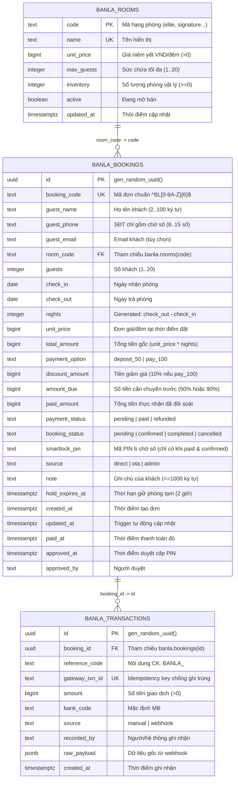

# MÔ HÌNH DỮ LIỆU & TRẠNG THÁI MIGRATION (`DATA_MODEL.md`)

> **Trạng thái tài liệu:** Khởi tạo Giai đoạn 0 (Orchestrator Baseline)  
> **Cập nhật lần cuối:** 2026-11-04

---

## 1. Tổng quan Kiến trúc Lưu trữ Dữ liệu

Dự án Banla hiện có **3 lớp mô hình dữ liệu** tồn tại song song trong mã nguồn và đang trong quá trình hợp nhất về **Supabase Schema `banla` (v2)**:

| Lớp lưu trữ | Vị trí / File định nghĩa | Trạng thái hoạt động | Ghi chú |
|---|---|---|---|
| **1. Supabase PostgreSQL Schema v2 + v3 (Mục tiêu chuẩn)** | [`supabase/sql/banla_schema_v2.sql`](../supabase/sql/banla_schema_v2.sql), [`supabase/sql/banla_v3_onepay_visa.sql`](../supabase/sql/banla_v3_onepay_visa.sql) | Đã viết & pass toàn bộ test PGlite (`test/schema_v2.test.js`, `test/visa_onepay.test.js`), **chưa tự động chạy lên Supabase thật** | Cách ly 100% trong schema `banla`; khóa RLS chặt chẽ; bổ sung `banla.payment_intents`, `banla.payment_events` và `banla.confirm_onepay_payment`. |
| **2. Local JSON Store (Đang chạy trên Express)** | [`rooms.json`](../rooms.json), [`data/bookings.json`](../data/bookings.json), `data/payments.json`, `data/payment_events.json` | **Đang hoạt động** làm kho lưu trữ nguyên tử (Atomic + Mutex) của `server.js` | Dùng định dạng `camelCase`, tự đồng bộ sang Supabase khi cấu hình `SUPABASE_SERVICE_ROLE_KEY`. |
| **3. Các bản SQL cũ / thử nghiệm (Đã ngưng hoặc chờ gộp)** | [`supabase_schema.sql`](../supabase_schema.sql) (v1), [`banla_payment_module/database/banla_migration.sql`](../banla_payment_module/database/banla_migration.sql), [`DFT2_bot/tgcloud/schema.js`](../DFT2_bot/tgcloud/schema.js) | **KHÔNG CHẠY** bản v1; `banla_migration.sql` chưa dùng; `DFT2_bot` đang để trống comment | Cần dọn dẹp hoặc gộp sau khi chủ dự án duyệt. |

> [!IMPORTANT]
> **Quy tắc Cách ly Tuyệt đối:** Trên project Supabase `hcikbpvzbzottxoitujl`, mọi bảng của Banla bắt buộc nằm trong schema `banla` (`banla.rooms`, `banla.bookings`, `banla.transactions`). Tuyệt đối không chạm vào các bảng thuộc schema `public` của dự án `webmoi`.

---

## 2. Sơ đồ Quan hệ Thực thể (ERD — Chuẩn Supabase Schema v2)

---

## 3. Chi tiết các Bảng & Ràng buộc (Schema v2)

### 3.1. Bảng `banla.rooms` (Danh mục 7 hạng phòng)
Lưu trữ nguồn giá chuẩn duy nhất trên CSDL để tự động tính tiền phía server/DB:

| `code` | `name` | `unit_price` (VND) | `max_guests` | `inventory` *(tạm tính)* |
|---|---|---|---|---|
| `elite` | Élite Room | 1.250.000 | 3 | 1 |
| `signature` | Banla Signature | 1.150.000 | 3 | 1 |
| `highland` | Highland Room | 1.100.000 | 3 | 1 |
| `connecting` | Connecting Room | 1.850.000 | 6 | 1 |
| `twin` | Deluxe Twin | 950.000 | 3 | 1 |
| `suite` | Original Suite | 1.550.000 | 3 | 1 |
| `balcony` | Deluxe Balcony | 980.000 | 3 | 1 |

### 3.2. Bảng `banla.bookings` (Đơn đặt phòng & Khóa Smart-Lock)
- **Các ràng buộc toàn vẹn (Constraints) quan trọng:**
  - `bookings_stay_valid`: `check_out > check_in` và số đêm tối đa `<= 30`.
  - `bookings_amounts_valid`: `discount_amount <= total_amount`, `amount_due <= total_amount - discount_amount`, `paid_amount <= total_amount - discount_amount`.
  - `bookings_pin_requires_paid`: `smartlock_pin IS NULL OR (payment_status = 'paid' AND booking_status IN ('confirmed', 'completed'))` — **Khóa cứng ở tầng CSDL**, đảm bảo đơn chưa thanh toán không bao giờ có mã PIN.
- **Cơ chế chống đặt trùng phòng (Overbooking Prevention):**
  - Trong hàm `public.banla_create_booking`, hệ thống dùng khóa tư vấn theo giao dịch `pg_advisory_xact_lock(hashtext('banla_room:' || v_room.code))` để đếm số đơn đang chiếm phòng (`paid`, `confirmed` hoặc còn hạn giữ chỗ `hold_expires_at > now()`) giao thoa khoảng ngày `check_in < p_check_out AND check_out > p_check_in`. Nếu `>= inventory`, từ chối tạo đơn.

### 3.3. Bảng `banla.transactions` (Lịch sử Giao dịch & Đối soát)
- Hỗ trợ thanh toán nhiều đợt (ví dụ: cọc trước, trả thêm sau) và **Idempotency** qua cột `gateway_txn_id UNIQUE` (nếu webhook gửi trùng cùng một mã giao dịch ngân hàng, hàm `banla.record_payment` trả về đơn hiện tại mà không cộng tiền 2 lần).

### 3.4. Các Hàm RPC trong Schema v2
| Tên hàm | Schema | Quyền gọi (`GRANT EXECUTE`) | Chức năng |
|---|---|---|---|
| `public.banla_create_booking` | `public` (`SECURITY DEFINER`) | `anon`, `authenticated`, `service_role` | Kiểm tra hợp lệ, kiểm tra phòng trống, tự tính giá/giảm giá/tiền cọc, tạo đơn giữ chỗ 2 giờ. |
| `public.banla_booking_status` | `public` (`SECURITY DEFINER`) | `anon`, `authenticated`, `service_role` | Tra cứu trạng thái đơn khi truyền đúng cả `p_booking_code` VÀ `p_guest_phone`; chỉ hiển thị `smartlock_pin` khi đã `paid` + `confirmed`. |
| `banla.record_payment` | `banla` | Chỉ `service_role` | Ghi nhận giao dịch vào `banla.transactions`, cộng dồn `paid_amount`, tự động chuyển `payment_status = 'paid'` khi `paid_amount >= amount_due`. |
| `banla.approve_booking` | `banla` | Chỉ `service_role` | Kiểm tra đơn đã trả đủ `amount_due`, gắn mã `smartlock_pin` 6 số và chuyển `booking_status = 'confirmed'`. |
| `banla.cancel_booking` | `banla` | Chỉ `service_role` | Hủy đơn, xóa `smartlock_pin`, xóa `hold_expires_at` để giải phóng phòng trống. |

---

## 4. Ánh xạ Trường Dữ liệu giữa JSON Store (`server.js`) và Supabase Schema v2

Hiện tại `data/bookings.json` (do `server.js` đọc/ghi) và `localStorage` (do `script.js` ghi) đang dùng tên trường `camelCase`, trong khi Supabase dùng `snake_case`. Dưới đây là bảng ánh xạ chuẩn để đồng bộ ở giai đoạn tiếp theo:

| Ý nghĩa | `data/bookings.json` (`server.js`) | `supabase/sql/banla_schema_v2.sql` | Ghi chú chênh lệch cần lưu ý |
|---|---|---|---|
| Mã đơn | `id` (VD: `m3abc123` hoặc `BL9821`) | `booking_code` (`^BL[0-9A-Z]{6}$`) & `id` (`UUID`) | `server.js` đang dùng `Date.now().toString(36)`, cần đổi sang chuẩn `BLxxxxxx`. |
| Tên khách | `name` | `guest_name` | `script.js` hiện lưu cả 2 khóa vào `localStorage`. |
| Số điện thoại | `phone` | `guest_phone` | Schema v2 chuẩn hóa chỉ giữ chữ số (`0-9`). |
| Email | `email` | `guest_email` | Có thể `null` hoặc chuỗi rỗng. |
| Hạng phòng | `room` (Tên hoặc mã) | `room_code` (FK `banla.rooms.code`) | Cần map tên hiển thị (`Original Suite`) về mã (`suite`). |
| Ngày nhận / trả | `checkin`, `checkout` (`YYYY-MM-DD`) | `check_in`, `check_out` (`DATE`) | Khớp định dạng ngày. |
| Tổng tiền gốc | `totalPrice` | `total_amount` | Tính bằng `unit_price * nights`. |
| Tiền cần trả trước | `depositAmount` | `amount_due` | Cọc 50% hoặc 90% (khi trả 100% được giảm 10%). |
| Tiền đã trả | `paidAmount` | `paid_amount` | Mặc định `0`. |
| Trạng thái TT | `paymentStatus` (`UNPAID` / `PAID` / `DEPOSIT_PAID`) | `payment_status` (`pending` / `paid` / `refunded`) | Cần chuẩn hóa chữ thường/chữ hoa qua adapter chung trong `shared/`. |
| Trạng thái đơn | `status` (`pending` / `confirmed` / `completed` / `cancelled`) | `booking_status` (`pending` / `confirmed` / `completed` / `cancelled`) | Đồng nhất 4 trạng thái. |
| Mã khóa phòng | `smartLockPin` | `smartlock_pin` | Schema v2 yêu cầu đúng 6 chữ số (`^[0-9]{6}$`). |

---

## 5. Trạng thái Migration Hiện tại

1. **Trên Supabase Cloud (`hcikbpvzbzottxoitujl`):**
   - Chưa có schema `banla` (`PGRST106 – Invalid schema: banla`).
   - **Tuyệt đối không chạy** [`supabase_schema.sql`](../supabase_schema.sql) ở thư mục gốc (bản v1) vì mở quyền `USING (true)` cho `anon`.
   - **Bản sẵn sàng chạy:** [`supabase/sql/banla_schema_v2.sql`](../supabase/sql/banla_schema_v2.sql) (chờ chủ dự án xác nhận số lượng phòng thực tế `inventory` của 7 hạng phòng và duyệt chạy).
2. **Trên Local / Test (`@electric-sql/pglite`):**
   - Toàn bộ 11 bài kiểm thử của `supabase/sql/banla_schema_v2.sql` trong [`test/schema_v2.test.js`](../test/schema_v2.test.js) đã **PASS 100%**.
3. **Trong `DFT2_bot/tgcloud/schema.js`:**
   - Hiện mới chỉ có phần khung mẫu đang comment (`// export const users = table(...)`), chưa tạo migration trên Telegram Cloud.

